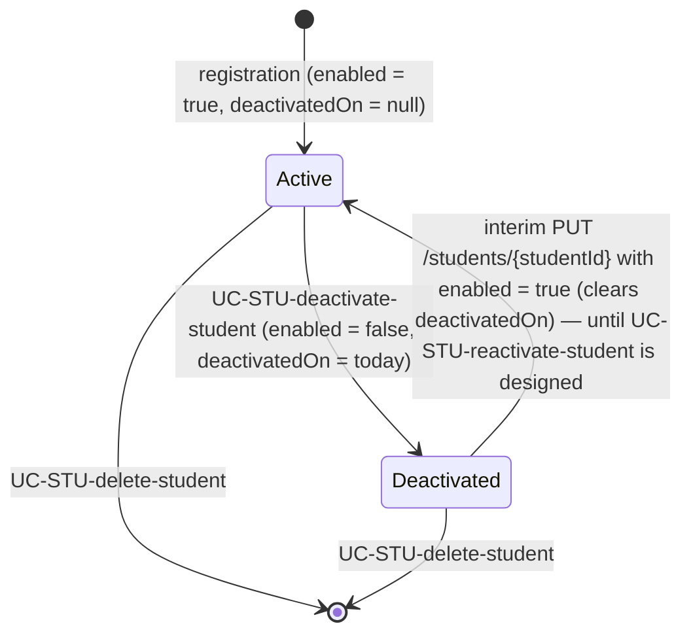
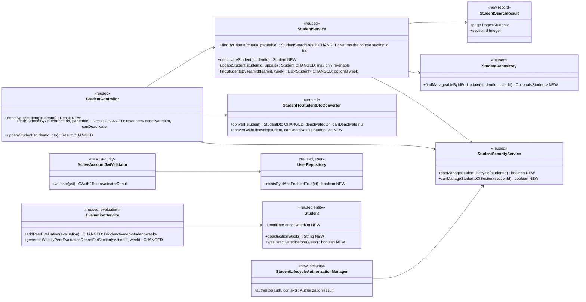
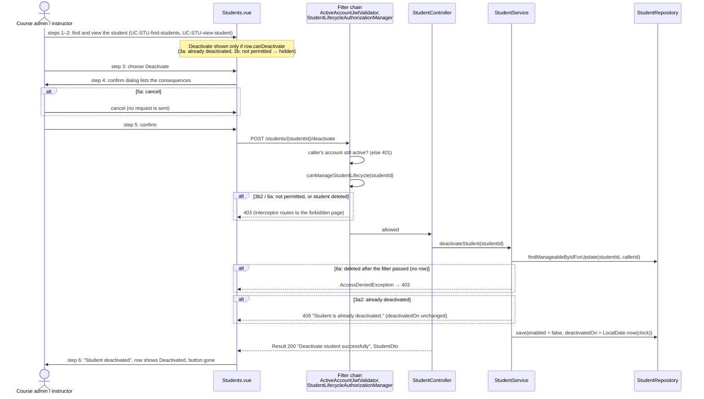
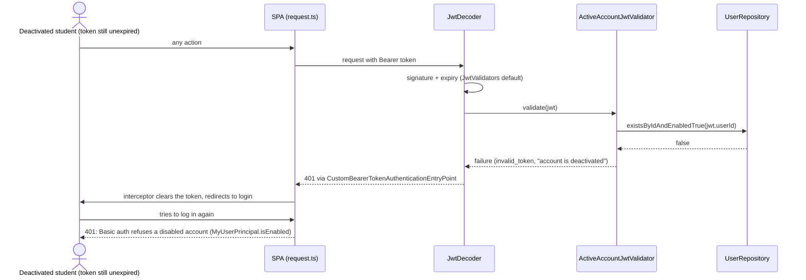
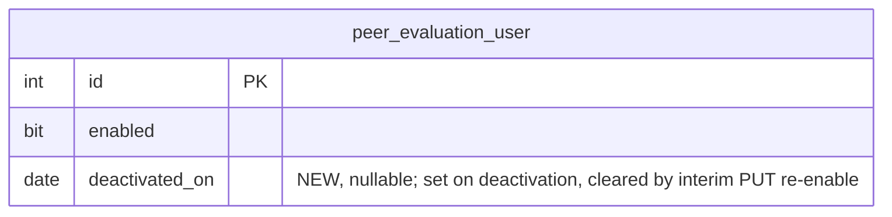

# Student (STU) Design

> Realizes: UC-STU-deactivate-student
> Depends on: FR-SEC-active-account, BR-student-lifecycle, BR-deactivated-student-weeks, BR-submission-owed, BR-section-scoped-access, BR-lock-expiry
> See: [use cases](../requirements/use-cases.md#student), [SRS security requirements](../requirements/software-requirements-specification.md#security-and-authorization-requirements), [architectural-design.md](architectural-design.md#architectural-conventions) (foundation component view, Authentication and Authorization)
> Designed against `main` at `59f0267` (2026-11-04); built on `implement/uc-stu-deactivate-student`, and this doc updated to match. The other STU use cases (invite, find, view, delete) were built before this workflow existed. Their spec→code map is in [`traceability.md`](../traceability.md), and this doc does not redesign them. UC-STU-reactivate-student is **not** designed here.

## Overview

A student account is either **active** or **deactivated** (the `enabled` flag on `PeerEvaluationUser`). Deactivation removes a student's access and records her **deactivation date**, but she keeps her team and her submitted work. Before this design, the only way to deactivate a student was the `enabled` switch in the generic Edit Student form (`PUT /students/{studentId}` → `StudentService.updateStudent`). That path asked for no confirmation and recorded no date. Its route rule also admitted only instructors of the student's course section, so a course admin who was not one of them was refused, although BR-student-lifecycle lets them act. And a student who was already logged in kept access until her token expired.

This design does four things:
1. It adds one confirmed action in the `student` slice.
2. It adds an active-account check to every bearer-token request in `security/` (FR-SEC-active-account).
3. It applies BR-deactivated-student-weeks where peer evaluations are submitted and reported, in the `evaluation` slice.
4. It narrows the generic PUT so that it can only re-enable a student. That keeps today's reactivation path working until UC-STU-reactivate-student is designed.

## Lifecycle

Deactivation is allowed only from Active. A second request is refused with 409 and keeps the original `deactivatedOn` (extension 3a).

## Components & classes

Backend, all in `backend/src/main/java/team/projectpulse/`:
- `student/StudentController.java`, `student/StudentService.java`, `student/StudentSecurityService.java`, `student/StudentRepository.java`: reused, with the changes in the diagram.
- `student/Student.java`: gains `deactivatedOn`, `deactivationWeek()`, which uses `WeekKeys.of`, and `wasDeactivatedBefore(week)`, the one comparison the report, the evaluation check and the teammates list share.
- `student/StudentSearchResult.java`: **new**, a record of the search page and the course section id it was scoped to.
- `student/dto/StudentDto.java` and `StudentToStudentDtoConverter`: the DTO gains `deactivatedOn` (`LocalDate`, null when active) and `canDeactivate` (`Boolean`). `convert` leaves both null and is used wherever a student can read the result (`/students/teams/{teamId}`, login); `convertWithLifecycle` fills `deactivatedOn` and is used for search rows, the single-student GET and the deactivate response, and only search rows pass a `canDeactivate`. A student never learns a teammate's deactivation date. The single-student GET does reach the student herself, but her own `deactivatedOn` is always null while she can make requests. `StudentDtoToStudentConverter` ignores both fields.
- `security/authorizationmanagers/StudentLifecycleAuthorizationManager.java`: **new**.
- `security/ActiveAccountJwtValidator.java`: **new**.
- `security/SecurityConfiguration.java`: one new route rule, and the validator wired into `jwtDecoder()`.
- `user/UserRepository.java`: one new finder.
- `system/exception/StudentStatusConflictException.java`: **new**, mapped to 409 in `ExceptionHandlerAdvice`.
- `evaluation/EvaluationService.java`: two changed methods.
- Migration `resources/db/migration/V7__student_deactivated_on.sql`: **new**.

Frontend, all in `frontend/src/`:
- `apis/student/index.ts` and `types.ts`: add `deactivateStudent(id)`, the two new `Student` fields, and an optional `week` argument to `findStudentsByTeamId`.
- `pages/students/Students.vue`: a **Deactivate** button in the Operations column, shown only when the row's `canDeactivate` is true, behind an `ElMessageBox.confirm`. This list is where UC-STU-view-student is realized (its traceability row cites `Students.vue`), so steps 2 and 3 both happen on the row. `EditStudentForm.vue` gets no Deactivate button. The status tag changes from Enabled / Disabled to **Active / Deactivated**.
  - The confirm dialog lists every consequence in the use case's Associated Information:
    - she can no longer log in or submit weekly activity reports and peer evaluations, and any session she has open ends on her next request;
    - her account, team and submitted work are kept;
    - she can be reactivated later;
    - deactivation is not deletion.
  - The dialog is titled "Deactivate <first name> <last name>?", with buttons **Deactivate** (danger) and **Cancel**.
  - On success the page shows `ElMessage.success('Student deactivated')` and reloads the list. A 409 or 403 is shown by the shared request interceptor, as a toast carrying the server's `message` or as the forbidden page.
- `pages/students/EditStudentForm.vue`: the Status switch can only turn a deactivated student back on. It is disabled when the student is active.
- `pages/evaluations/SubmitTeamsEvaluations.vue`: passes the week being evaluated to `findStudentsByTeamId(teamId, previousWeek)`, so the server leaves out any teammate whose deactivation week is earlier than that week.

## Sequence

### UC-STU-deactivate-student, main success scenario

### The deactivated student's next request (FR-SEC-active-account)

## API contract

| Endpoint or job | Caller (who may) | Request | Success | Errors, by extension |
|---|---|---|---|---|
| `POST /api/v1/students/{studentId}/deactivate` | an instructor of the student's course section, or the course admin of its course (BR-student-lifecycle) | path `studentId`; no body | 200, `Result` with the updated `StudentDto` (`enabled` false, `deactivatedOn` set) | 3a2: 409 `CONFLICT`, "Student is already deactivated."; `deactivatedOn` unchanged. 3b2 and 6a: 403, a permission error (caller not permitted, or unknown id) |
| `POST /api/v1/students/search` (changed) | unchanged | unchanged | each row also carries `deactivatedOn` and `canDeactivate` | unchanged |
| `PUT /api/v1/students/{studentId}` (changed) | unchanged | an `enabled` of **true** re-enables a deactivated student and clears `deactivatedOn`; an `enabled` of false is **ignored**; `true` on an active student changes nothing (`StudentDto.enabled` is a primitive `boolean`, so it is never null) | unchanged | unchanged |
| `GET /api/v1/students/teams/{teamId}` (changed) | unchanged | optional query `week` (a week key) | with `week`: leaves out any member whose deactivation week is earlier than `week`; without it: unchanged. `deactivatedOn` is always null here | 400 for a malformed `week` (`WeekKeys.requireValid`) |
| `POST /api/v1/evaluations` (changed) | unchanged | unchanged | unchanged | 400 `PeerEvaluationIllegalArgumentException`, "<first name> was deactivated before that week and cannot be evaluated for it.", when the evaluatee's deactivation week is earlier than the evaluation's week (BR-deactivated-student-weeks) |
| `GET /api/v1/evaluations/sections/{sectionId}/week/{week}` (changed) | unchanged | unchanged | leaves out any student whose deactivation week is earlier than `week` | unchanged |
| Every bearer-token request (changed) | any authenticated user | the JWT | unchanged | 401 when the token's `userId` claim is missing, not a number, or names an account that is missing or not enabled (FR-SEC-active-account). The validator returns `invalid_token` with the description "This account is deactivated.", which reaches `ExceptionHandlerAdvice` as `InvalidBearerTokenException` and returns the usual 401 `Result` envelope |

## Key decisions

- **An active-account check on every authenticated request (FR-SEC-active-account).** `ActiveAccountJwtValidator` is an `OAuth2TokenValidator<Jwt>` added beside the default validators in `jwtDecoder()`. It reads the `userId` claim and calls `UserRepository.existsByIdAndEnabledTrue`. A disabled or missing account fails validation, so the request gets a 401 and the SPA's interceptor logs the user out. The same check covers instructors, because it reads the shared `peer_evaluation_user` table. The cost is one primary-key lookup per request. *Rejected:* caching the result, because any cache lifetime reopens the window the FR forbids. *Rejected:* a token-version claim, which still needs a lookup per request to compare against. *Rejected:* shorter tokens, which shrink the window but don't close it. This changes the architecture-of-record's Authentication section and narrows TD-jwt-revocation. Both edits are part of this change and were approved for it.
- **Interim reactivation asks `StudentSecurityService` from the service.** `StudentService` now depends on `StudentSecurityService` for that one check, the same rule the route uses, so there is one definition of who may manage a student's lifecycle.
- **One action route, not a generic status field.** The deactivation has its own rules: a 409 when the student is already deactivated, keeping the original date, and a date to record. It also needs its own route rule, separate from `PUT /students/{studentId}`, which admits the student herself through `UserOwnershipAuthorizationManager`. *Rejected:* keeping deactivation on the PUT, which skips confirmation and records no date. Taking the role check out of `updateStudent` also removes the `SecurityContextHolder` call there that OI-63 lists, and with it the instructor-role branch. Interim reactivation (`enabled` true on the PUT) becomes allowed only to the callers `canManageStudentLifecycle` admits: `updateStudent` checks that through `StudentSecurityService` before honouring `enabled`, and ignores `enabled` otherwise.
- **Interim reactivation through the PUT clears `deactivatedOn`.** You chose this. Until UC-STU-reactivate-student records a reactivation date, a student re-enabled this way shows in every week. *Rejected:* keeping the date, which would hide an active student from every report after her old deactivation week.
- **Who may act: `canManageStudentLifecycle`.** The caller must be in `student.section.instructors` (the instructors of the course section, not the team's instructors and not the caller's default course section) or be `student.section.course.courseAdmin`. A role alone, `ROLE_admin` included, grants nothing. The route rule is `.access(studentLifecycleAuthorizationManager)` only, with no `hasAuthority`. No existing `/students/...` pattern matches `/students/{studentId}/deactivate`, so rule order doesn't matter. Like the other `*SecurityService` checks, it fails closed: an unknown id is a 403 (6a), never a 404, so the response doesn't reveal which ids exist. *Rejected:* widening `isCurrentUserInstructorOfStudentSection`, which also guards private peer-evaluation details (`StudentInstructorAuthorizationManager`).
- **The button is hidden when the action is not allowed (3a1, 3b1).** The search results carry `canDeactivate` = the student is active **and** the caller may manage her course section. All search rows come from the caller's current course section (`StudentSpecs.belongsToSection(userUtils.getUserSectionId())`), so the controller calls `canManageStudentsOfSection(sectionId)` once per request rather than once per row. `StudentService.findByCriteria` returns that section id alongside the page. The server still enforces both checks (3a2, 3b2). *Rejected:* inferring permission in the browser from the JWT roles, which don't say which course section a user instructs.
- **The service loads the student scoped to the caller and locks the row.** `StudentRepository.findManageableByIdForUpdate(studentId, callerId)` is a JPQL query with `@Lock(PESSIMISTIC_WRITE)`. It returns the student only when the caller is in `section.instructors` or is `section.course.courseAdmin`. This is point 2 of the architecture-of-record's Authorization model: scope goes in the query, not in a check after an unscoped `findById`.
  - When nothing comes back, either because the student was deleted after the filter passed (6a) or because scope was lost some other way, the service throws Spring's `AccessDeniedException`, which `ExceptionHandlerAdvice` already maps to 403 "No permission.". It is never `ObjectNotFoundException` and never a 404, so 6a gives the permission error that 6a1 requires.
  - The row lock makes the second of two simultaneous requests wait, then see `enabled` false and get a 409, so 3a2 holds even under a race.
  - The scope conditions are `exists` subqueries, not joins. MySQL's `FOR UPDATE` locks every joined row, and a subquery's rows only when it has its own locking clause, so this way only the student's row is locked, not her course section or course.
  - *Rejected:* an `@Version` column, which would add a migration and a retry path for a rare race.
- **Already deactivated returns 409 and keeps the original date (3a2).** `StudentStatusConflictException`, mapped like `SectionAlreadyLockedException`, is thrown before any write. The message is "Student is already deactivated." *Rejected:* an idempotent 200, which 3a2 rules out.
- **Deactivation date and week (BR-deactivated-student-weeks).** `deactivatedOn` is a `LocalDate` taken from the injected `Clock`, so the dev profile's fixed clock moves it too. The deactivation week is `WeekKeys.of(deactivatedOn)`. `WeekKeys` uses ISO weeks, running Monday to Sunday, with keys like `2023-W33`. `PeerEvaluation.week` and the active weeks use the same keys, and the clock's zone is `app.timezone` (America/Chicago). The keys are zero-padded, so comparing them as strings also orders them in time. *Rejected:* a timestamp, because the rule is stated in weeks.
- **Team membership is kept.** Deactivation never touches `student.team`. *Rejected:* removing her from the team, which the rule forbids, and which would leave reactivation unable to put her back.
- **Peer evaluations of a deactivated teammate.** Two places change, as the rule requires.
  - `EvaluationService.addPeerEvaluation` refuses an evaluation whose evaluatee's deactivation week is earlier than the evaluation's week. The check runs after the existing same-team check. Each evaluation is posted on its own, so only the one out-of-range evaluation fails.
  - `updatePeerEvaluation` needs no check. An evaluation can only be created for the previous week, and a student can only be deactivated today, so any evaluation of her that already exists is for a week no later than her deactivation week.
  - `generateWeeklyPeerEvaluationReportForSection` leaves her row out (the row in which she is the person evaluated) for any week after her deactivation week. She can't submit evaluations after deactivation, so she never appears there as an evaluator. The report has no "not submitted" list (that lives in `SubmissionStatusService`), so it never shows her as owing anything.
  - The form asks the server for the teammates of the evaluated week, through `GET /students/teams/{teamId}?week=`, so it shows her exactly for the weeks the server accepts. For those weeks, evaluating her stays optional: `SubmissionStatusService` already counts only active teammates as owed (BR-submission-owed, unchanged), and the form already lets the evaluator leave a teammate unevaluated, so neither changes.
  - *Rejected:* returning only active members from `GET /students/teams/{teamId}`, because she must still appear for the weeks up to and including her deactivation week. *Rejected:* sending teammates her deactivation week and filtering in the browser, which would show students a teammate's deactivation date and would put the rule in two places.
  - The rule names only the section report and teammates' evaluations, so other reports are unchanged. That includes UC-EVA-student-evaluation-report and her own past evaluations.
- **Locks are not released at deactivation.** Any document section or use case lock she holds stops being renewed, because her next request is refused, and it is freed under BR-lock-expiry. *Rejected:* having the foundation `student` slice call `ram/*` lock services.
- **No notification on deactivation.** The use case has no notification step.

## Data model

One column. The SRS's Business Domain Model is otherwise unaffected.

`V7__student_deactivated_on.sql` adds `deactivated_on DATE NULL` to `peer_evaluation_user`, the single table that holds both students and instructors. It is mapped on `Student` only.

## Reuse & cross-cutting

These existing pieces are reused:
- the authorization-manager pattern;
- Spring's `OAuth2TokenValidator` chain on the existing `jwtDecoder()`;
- the `Result` envelope with the `ExceptionHandlerAdvice` mapping;
- `WeekKeys` and the injected `Clock`;
- `PeerEvaluationIllegalArgumentException`;
- `SubmissionStatusService`, unchanged;
- BR-lock-expiry.

The **architecture-of-record changes** in two places: [Authentication](architectural-design.md#authentication) gains the active-account check, and [TD-jwt-revocation](architectural-design.md#risks-and-technical-debt) narrows to leaked-token revocation.

## Tests

| Use case, flow | Level (unit / integration) | Asserts |
|---|---|---|
| UC-STU-deactivate-student, main (instructor of the course section) | integration | Bill Gates deactivates John Smith: 200, `enabled` false, `deactivatedOn` is the clock's date; John's Basic-auth login then returns 401 |
| UC-STU-deactivate-student, main (course admin not assigned to the course section) | integration + unit | Integration: inside the test, take Bingyang Wei (course admin of John's course) out of the course section's instructors, then he deactivates John: 200. Unit: `canManageStudentLifecycle` is true for `courseAdmin` alone |
| UC-STU-deactivate-student, main: logged-in student refused (FR-SEC-active-account) | integration | John's JWT, issued before deactivation, gets 401 on his next request (`POST /activities/search`) |
| active-account check applies to instructors | unit (`ActiveAccountJwtValidator`) | a token whose `userId` is a disabled account, or no account, fails; an enabled account passes |
| UC-STU-deactivate-student, 3a already deactivated | unit + integration | second deactivation gets 409 "Student is already deactivated."; `deactivatedOn` keeps the first date; `canDeactivate` is false for that row |
| UC-STU-deactivate-student, 3b instructor of another course section | integration | Tim Cook deactivating John Smith gets 403; `canDeactivate` is false for a section Tim does not manage (unit) |
| UC-STU-deactivate-student, 3b the student herself | integration | John deactivating himself gets 403 |
| UC-STU-deactivate-student, 5a cancel | none | client-only: no request is sent, and there is no frontend test harness |
| UC-STU-deactivate-student, 6a student deleted | integration + unit | unknown student id gets 403 from the filter (integration); `findManageableByIdForUpdate` returning empty makes the service throw `AccessDeniedException`, not `ObjectNotFoundException` (unit) |
| BR-deactivated-student-weeks, evaluation allowed up to her deactivation week | unit (`EvaluationService`) | an evaluation of her for her deactivation week is saved |
| BR-deactivated-student-weeks, evaluation refused after it | unit + integration | Integration: set John's `deactivatedOn` to 2023-08-01 (week 2023-W31) in the test, then Eric evaluates John for 2023-W32 (the previous week under the dev clock): 400 with the message above. A later week can't be used, because the submission-window check runs first |
| BR-deactivated-student-weeks, section report | unit | the report for her deactivation week includes her; the report for a later week leaves her out |
| BR-deactivated-student-weeks, team kept | integration | after deactivation John's `teamId` is unchanged |
| BR-deactivated-student-weeks, teammates for a week | integration | with John's `deactivatedOn` in 2023-W31, `GET /students/teams/{teamId}?week=2023-W32` leaves him out, `?week=2023-W31` includes him, and no member carries `deactivatedOn` |
| active-account check, malformed token claim | unit | a token with no `userId` claim fails validation |
| interim PUT | unit + integration | `enabled` false in the body changes nothing; `enabled` true from a permitted caller re-enables and clears `deactivatedOn`; `enabled` true from the student herself is ignored |

## Test fixtures

Integration tests use the seed data:
- **Permitted caller:** Bill Gates (`b.gates@abc.edu`), an instructor of John's course section and not a course admin.
- **Instructor of another course section:** Tim Cook.
- **Student:** John Smith (`j.smith@abc.edu`); his teammate Eric Hudson evaluates him.
- **Course admin:** Bingyang Wei (course admin of John's course; take him out of the course section's instructors within the test for the course-admin-only case).

`AbstractIntegrationTest` rolls back each test's transaction, so changes made in one test, such as deactivating John, leave him active for the next.

- MockMvc runs requests on the test's thread, inside its transaction, so a later login or JWT request in the same test sees the uncommitted `enabled = false`.
- The fixed dev `Clock` is Sunday 2023-08-20 23:30 America/Chicago, so a deactivation in a test falls in week 2023-W33, and the "previous week" for evaluations is 2023-W32.
- No seed row is added; `V7` is the next free migration number after `V6__activity_category_as_string.sql`. The dev profile uses `ddl-auto: create`, so the entity mapping, not the migration, builds the dev schema. Prod and staging run the migration.

## Open questions / risks

- The per-request lookup adds one primary-key query to every API call. It is an indexed single-row read, so it should stay well inside the SRS's performance attributes. `/implement` found no performance tests in the backend to check it against, so this is still unmeasured.
- A student reactivated through the interim PUT shows in the reports for the weeks she was inactive. UC-STU-reactivate-student will replace that path and record a reactivation date.
